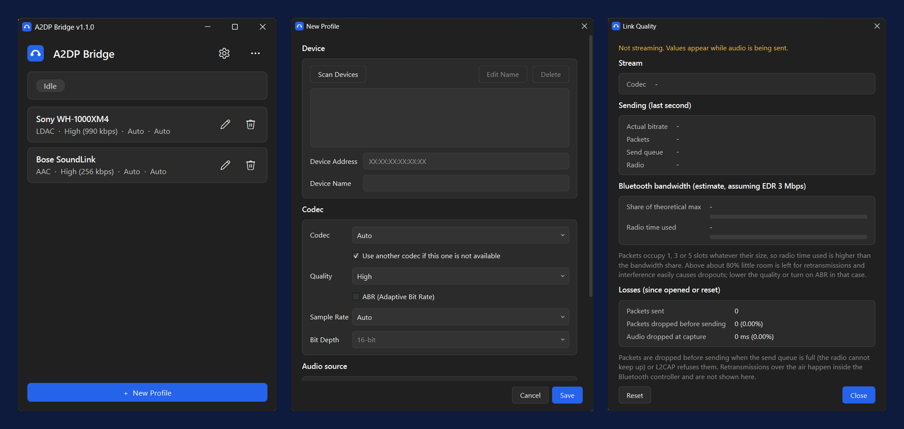

# A2DP Bridge

Stream Windows system audio to Bluetooth headphones with high-quality codecs (LDAC, aptX HD, aptX LL, aptX, AAC, SBC, experimental LHDC V5) through a USB Bluetooth adapter. No kernel driver or test signing needed.



## Codecs

| Codec | Bitrate | Sample rate | Bit depth |
|-------|---------|-------------|-----------|
| LDAC | 330 / 660 / 990 kbps | 44.1–96 kHz | 16 / 24 / 32 |
| aptX HD (experimental) | 576 kbps | 44.1 / 48 kHz | 24 |
| aptX Low Latency (experimental) | 352 kbps | 44.1 / 48 kHz | 16 |
| aptX | 352 / 384 kbps | 44.1 / 48 kHz | 16 |
| AAC | 128 / 192 / 256 kbps | 44.1 / 48 kHz | 16 |
| SBC | up to ~345 kbps | 44.1 / 48 kHz | 16 |
| LHDC V5 (experimental) | 400–1000 kbps | 44.1–192 kHz | 16 / 24 |

Auto mode picks the best codec your headphones support. aptX Adaptive is not supported.

## Requirements

- Windows 10 / 11 (x64)
- A **dedicated** USB Bluetooth adapter (keep the built-in one for normal use)
- [Zadig](https://zadig.akeo.ie/) to install the WinUSB driver on that adapter

## Setup

1. Plug in the USB adapter.
2. In Zadig: Options → List All Devices, pick the adapter, choose **WinUSB**, click **Replace Driver**.
3. Realtek adapters (e.g. TP-Link UB500) need firmware: open **⋯ → Bluetooth Firmware Selection** and follow the steps. CSR adapters need none.
4. Start the app, click **New Profile**, pick your headphones and codec, then connect.

> **Never replace the driver on your PC's built-in Bluetooth adapter.** It would disable all normal Bluetooth (keyboards, mice, audio).

## Command line

```bash
A2DPWB.exe --cli -l                                  # list paired devices
A2DPWB.exe --cli -d AA:BB:CC:DD:EE:FF                # connect, auto codec
A2DPWB.exe --cli -d AA:BB:CC:DD:EE:FF -c ldac -q hq  # choose codec and quality
A2DPWB.exe --cli -h                                  # all options
```

## Build

Needs Visual Studio 2022+ (C++), CMake 3.16+, Git and Qt 6.5+ (MSVC 64-bit kit).

```bash
git clone --recursive <this repository>
cd A2DP-Bridge
cmake -B build -A x64 -DCMAKE_PREFIX_PATH=D:/Qt/6.8.3/msvc2022_64
cmake --build build --config Release
```

`cmake --build build --target A2DPWB_dist` creates the portable package in `build/dist`.

## Built with

[BTstack](https://github.com/bluekitchen/btstack) · [libldac](https://android.googlesource.com/platform/external/libldac) · [libopenaptx](https://github.com/pali/libopenaptx) · [fdk-aac](https://github.com/mstorsjo/fdk-aac) · [LHDC-V5-Encoder](https://github.com/WillyBilly06/LHDC-V5-Encoder) · [Qt](https://www.qt.io/) · [nlohmann/json](https://github.com/nlohmann/json)

## Credits

A2DP Bridge is based on [A2DP Windows Bridge](https://github.com/SeiyaFunaokaJP/A2DP-Windows-Bridge) by Seiya Funaoka, which provides the audio, codec and Bluetooth backend. This version has a rebuilt Qt 6 interface.
